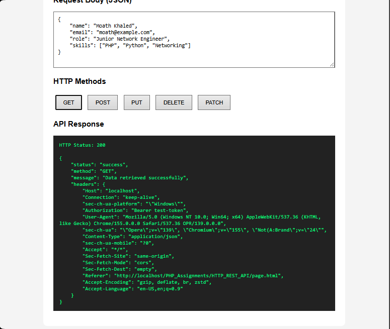
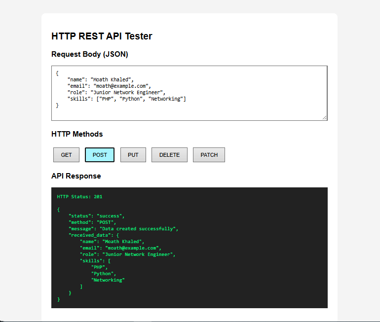
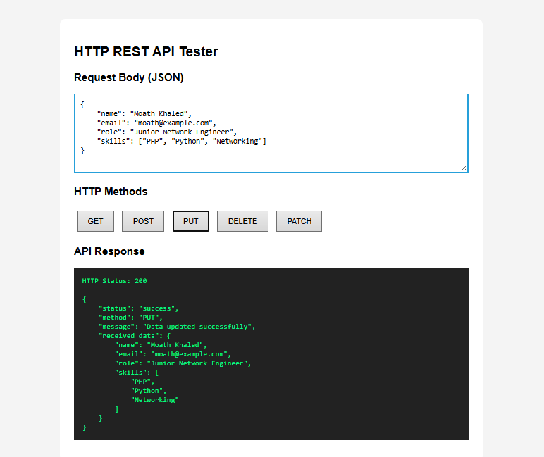
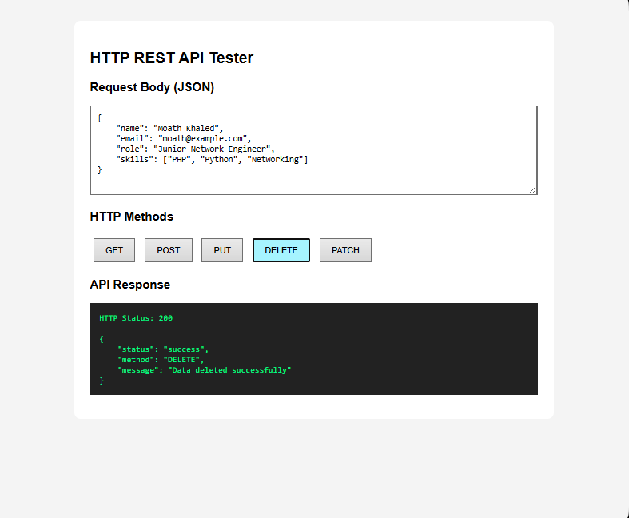
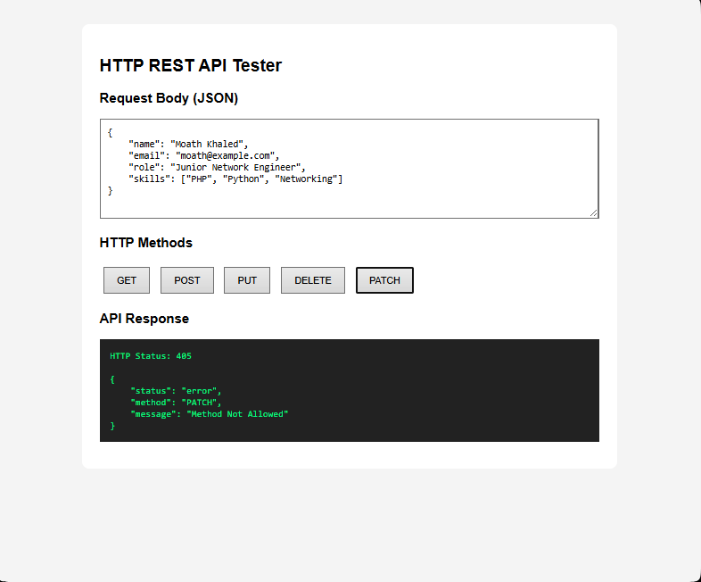

# HTTP REST API using PHP

A simple REST API developed using **PHP** to demonstrate HTTP methods, request headers, JSON data handling, and HTTP response status codes.

## Overview

This project demonstrates the fundamentals of building a REST API using PHP. It supports GET, POST, PUT, and DELETE methods and returns structured JSON responses.

A simple HTML and JavaScript interface is included to test API requests using the Fetch API without requiring Postman.

## Features

- **GET:** Retrieve request information and HTTP headers.
- **POST:** Receive JSON data and simulate resource creation.
- **PUT:** Receive JSON data and simulate resource updates.
- **DELETE:** Simulate resource deletion.
- **JSON Parsing:** Read and decode JSON request bodies.
- **HTTP Headers:** Read incoming request headers.
- **Error Handling:** Detect invalid JSON input.
- **HTTP Status Codes:** Return appropriate response codes.
- **Method Validation:** Reject unsupported HTTP methods.

## Technologies Used

- PHP
- HTML5
- CSS3
- JavaScript
- Fetch API
- JSON
- Apache (XAMPP)

## Project Structure

```bash
HTTP_REST_API/
│
├── index.php
├── page.html
├── README.md
│
└── screenshots/
    ├── api-get.png
    ├── api-post.png
    ├── api-put.png
    ├── api-delete.png
    └── api-error.png
```


## Installation and Setup
**Requirements**
- Windows OS
- XAMPP
- PHP
- Apache Web Server
- Web Browser

**Steps**

1. Install and configure XAMPP.
2. Place the project in your Apache-accessible directory.
3. Start Apache from XAMPP Control Panel.
4. Open the testing interface in your browser.


## Project URL
```bash
http://localhost/bootcamp/HTTP_REST_API/page.html
```

## API Methods

Method	Description	HTTP Status
GET	Retrieve request information	200 OK
POST	Simulate creating a resource	201 Created
PUT	Simulate updating a resource	200 OK
DELETE	Simulate deleting a resource	200 OK
PATCH	Unsupported method	405 Method Not Allowed

## Example JSON Request
```bash
{
    "name": "Moath Khaled",
    "email": "moath@example.com",
    "role": "Junior Network Engineer",
    "skills": [
        "PHP",
        "Python",
        "Networking"
    ]
}
```

## Example JSON Response
```bash
{
    "status": "success",
    "method": "POST",
    "message": "Data created successfully",
    "received_data": {
        "name": "Moath Khaled",
        "email": "moath@example.com",
        "role": "Junior Network Engineer",
        "skills": [
            "PHP",
            "Python",
            "Networking"
        ]
    }
}
```

```text
HTTP Status Codes
Status Code	Description
200	OK - Request processed successfully
201	Created - Resource creation simulated
400	Bad Request - Invalid JSON format
405	Method Not Allowed - Unsupported HTTP method
```

## Testing the API

**The project includes a web-based testing interface.**
1. Open page.html through the local Apache server.
2. Enter JSON data in the request body field.
3. Select an HTTP method.
4. Click the corresponding button.
5. View the HTTP response status and JSON result.

## Screenshots

### GET Request


### POST Request


### PUT Request


### DELETE Request


### Invalid JSON Response


## Learning Outcomes

**Through this project, I practiced:**
- Understanding REST API fundamentals.
- Working with HTTP request methods.
- Reading HTTP request headers using PHP.
- Receiving and decoding JSON data.
- Returning structured JSON responses.
- Handling HTTP status codes.
- Using JavaScript Fetch API to communicate with PHP.
- Handling invalid JSON input.
- Testing API endpoints through a browser interface.

## Important Notes

This project is an educational demonstration of REST API fundamentals.
- POST, PUT, and DELETE simulate resource operations.
- No database is connected.
- Data is not permanently stored or modified.
- The API focuses on HTTP methods, JSON communication, and response handling.

## Author
**Eng. Moath Al-Haz**