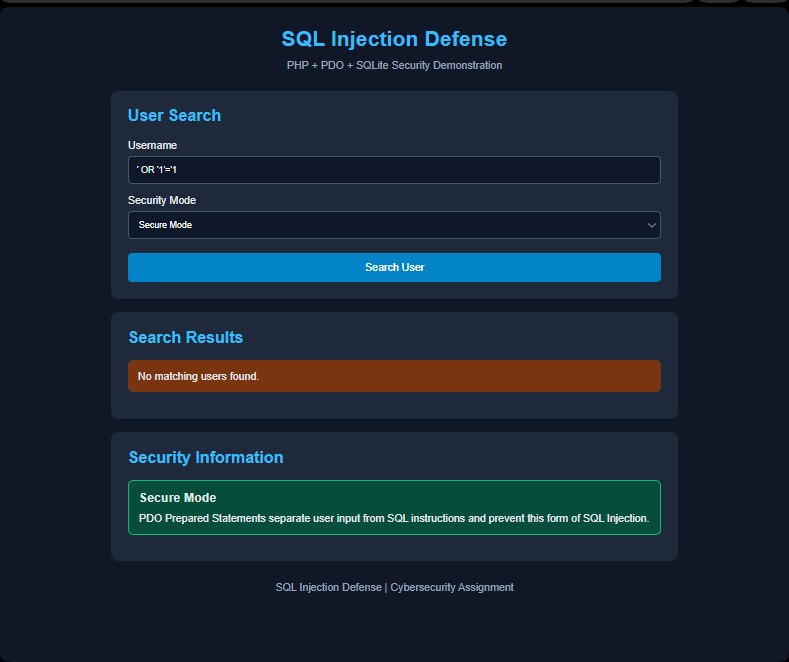
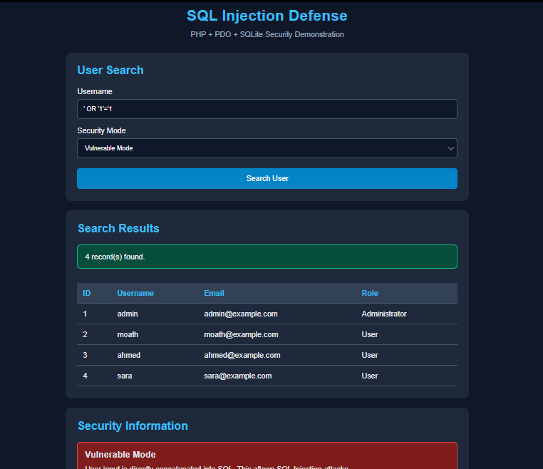

# SQL Injection Defense

A PHP-based web application demonstrating SQL Injection vulnerabilities and their prevention using PDO Prepared Statements and SQLite.

The project provides two security modes (Vulnerable and Secure) to demonstrate how unsafe SQL queries can expose database records and how parameterized queries prevent SQL Injection attacks.

## 🎯 Project Objectives

- Understand how SQL Injection vulnerabilities occur.
- Demonstrate the risks of directly concatenating user input into SQL queries.
- Implement secure database queries using PDO Prepared Statements.
- Compare vulnerable and secure SQL query execution.
- Test the application using common SQL Injection payloads.
- Handle database errors without exposing sensitive information.

## 🛠️ Technologies Used

| Technology | Purpose |
|---|---|
| PHP 8.x | Backend development |
| PDO | Database connectivity |
| SQLite | Lightweight database |
| HTML5 | Application structure |
| CSS3 | User interface styling |
| XAMPP | Local development environment |

## ✨ Features

- **User Search:** Search for users by username.
- **Vulnerable Mode:** Demonstrates SQL Injection through direct input concatenation.
- **Secure Mode:** Uses PDO Prepared Statements to prevent SQL Injection.
- **Test Database:** Automatically creates a users table and inserts four sample records.
- **Error Handling:** Prevents database error details from being exposed.
- **Output Sanitization:** Uses `htmlspecialchars()` to safely display database values.
- **Security Feedback:** Displays the selected security mode and search results.

## 📂 Project Structure

```text
SQLi-Defense/
│
├── index.php
├── style.css
├── README.md
│
└── screenshots/
    ├── secure-mode.png
    └── vulnerable-mode.png
```

## ⚙️ Installation & Setup

### 1. Clone the Repository

```bash
git clone
```

### 2. Move the Project

Move the project folder into XAMPP's `htdocs` directory:

```text
C:\xampp\htdocs\SQLi-Defense
```

### 3. Start XAMPP

Open XAMPP Control Panel and start:

- Apache

SQLite does not require MySQL to be running.

### 4. Enable PHP Extensions

Make sure the following extensions are enabled in your `php.ini`:

```ini
extension=pdo_sqlite
extension=sqlite3
```

### 5. Run the Application

Open your browser and navigate to:

```text
http://localhost/SQLi-Defense/
```

## 🧪 SQL Injection Demonstration

The application uses two different approaches to execute database queries.

### 1. Vulnerable Mode

The vulnerable implementation directly concatenates user input into the SQL query.

**Example:**

```php
$sql = "SELECT * FROM users
        WHERE username = '$username'";

$stmt = $pdo->query($sql);
```

This approach allows an attacker to manipulate the SQL query through malicious input.

### 2. Secure Mode

The secure implementation uses PDO Prepared Statements.

**Example:**

```php
$sql = "SELECT * FROM users
        WHERE username = :username";

$stmt = $pdo->prepare($sql);

$stmt->execute([
    ':username' => $username
]);
```

Prepared Statements separate SQL instructions from user-supplied data, preventing the tested SQL Injection attack.

## 🔬 Security Testing

The following payload was used to test the application's security:

```sql
' OR '1'='1
```

### Test Results

| Test Case | Vulnerable Mode | Secure Mode |
|---|---|---|
| SQL Injection payload | 4 records | 0 records |
| Unknown username | 0 records | 0 records |

### Security Demonstration


**1. Secure Mode – SQL Injection Prevention**

The SQL Injection payload is treated as ordinary text, and no matching records are returned.



**1. Vulnerable Mode – SQL Injection Exploitation**

The same payload successfully manipulates the SQL query and retrieves all four database records




## 🔐 Security Recommendations

- Always use PDO Prepared Statements.
- Never concatenate untrusted user input directly into SQL queries.
- Validate user input before processing it.
- Use `htmlspecialchars()` when displaying untrusted data in HTML.
- Avoid exposing database errors and internal application details.
- Apply the principle of least privilege to database accounts.
- Never deploy intentionally vulnerable code in production environments.

## 📚 Key Learning Outcomes

Through this project, I gained practical experience in:

- Understanding SQL Injection vulnerabilities.
- Working with PHP PDO and SQLite.
- Implementing Prepared Statements.
- Testing common SQL Injection payloads.
- Comparing vulnerable and secure database operations.
- Applying secure coding practices.

## ⚠️ Disclaimer

This project was developed for educational purposes as part of a cybersecurity training assignment.

The Vulnerable Mode is intentionally insecure and should only be used in a controlled local testing environment.

**Never use vulnerable code in production applications.**

---

**Project:** SQL Injection Defense  
**Category:** Web Application Security  
**Language:** PHP  
**Database:** SQLite  
**Focus:** SQL Injection Prevention