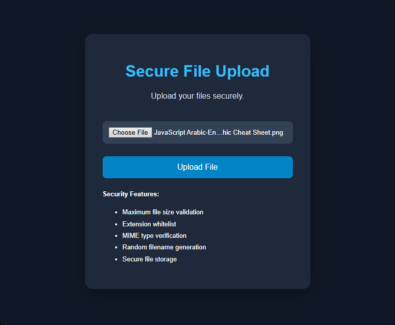
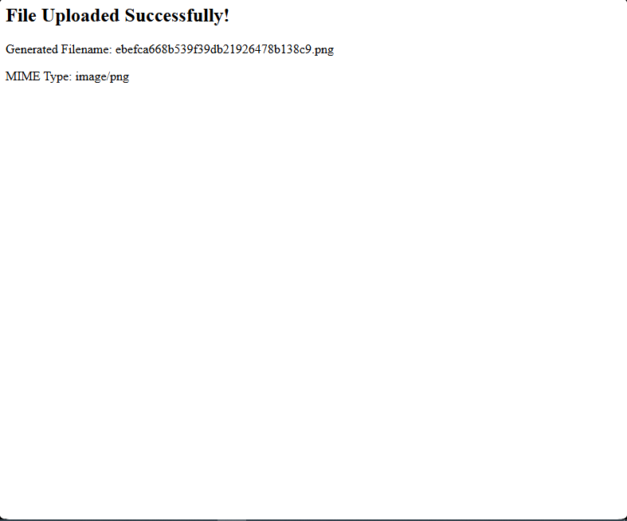
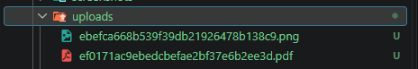
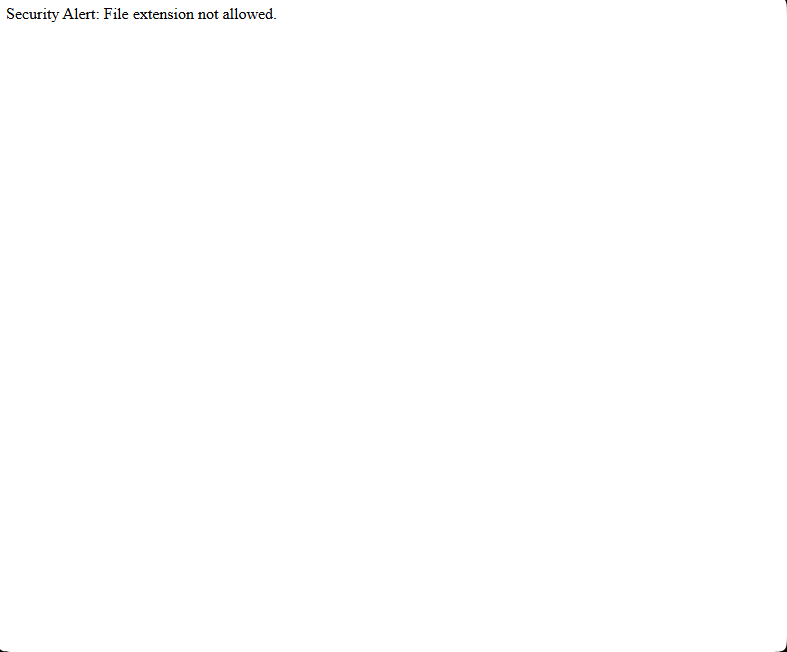

# 🔐 Secure File Upload System

A PHP-based Secure File Upload System designed to demonstrate the **Defense in Depth** security strategy.

The application implements multiple security validation layers to prevent malicious file uploads, Web Shell uploads, file extension spoofing, and unauthorized file storage.

## 📌 Project Overview

This project was developed as part of the Cybersecurity Bootcamp assignments.

It demonstrates how to build a secure file upload mechanism using PHP by validating uploaded files through multiple security checks before allowing them to be stored on the server.

Instead of trusting the filename or browser-provided headers, the system independently inspects the uploaded file's actual MIME type using PHP Fileinfo.

## 🚀 Features

- **File Size Validation:** Restricts uploaded files to a maximum size of 5 MB.
- **Extension Whitelist:** Only allows PDF, PNG, JPG, and JPEG files.
- **MIME Type Verification:** Uses PHP Fileinfo to inspect the actual file content.
- **Extension Spoofing Protection:** Detects files whose extensions do not match their actual content.
- **Random Filename Generation:** Generates unpredictable filenames using `random_bytes()` and `bin2hex()`.
- **Secure File Storage:** Uses `move_uploaded_file()` to store validated files.
- **File Permissions:** Applies restricted file permissions using `chmod()`.
- **Upload Error Handling:** Checks PHP upload errors before processing files.

## 🛡️ Security Layers

| Security Layer | Implementation | Purpose |
|---|---|---|
| File Size Validation | `$_FILES['size']` | Prevents oversized uploads |
| Extension Validation | `pathinfo()` | Enforces an extension whitelist |
| MIME Inspection | `finfo_file()` | Verifies actual file type |
| Random Naming | `random_bytes()` | Prevents filename prediction |
| Secure File Movement | `move_uploaded_file()` | Ensures uploaded-file origin |
| File Permissions | `chmod()` | Restricts file permissions |
| Output Encoding | `htmlspecialchars()` | Prevents HTML injection in output |

## 🧰 Technologies Used

- PHP 8.x
- HTML5
- CSS3
- Apache Web Server
- XAMPP
- PHP Fileinfo Extension

## 📂 Project Structure

```text
secure_file_upload/
│
├── index.php
├── upload.php
├── uploads/
├── README.md
└── screenshots
    ├── main_mune.png
    ├── upload-php.png
    ├── random-filename.png
    ├── upload-png.png
    └── upload-txt.png
```
## ⚙️ Installation and Setup
    
### 1. Clone the Repository

```bash
git clone https://github.com/moathalhazi/Bootcamp/tree/main/Programming_Languages/PHP_Assignments/Secure_File_Upload
```

### 1. Create the Upload Directory

Create a directory named:

```text
uploads/
```

Ensure that the Apache server has permission to write to this directory.

### 2. Run the Application

Open your browser and navigate to:

```text
http://localhost/Secure_File_Upload/
```

Select a file and click **Upload File**.

## 🧪 Security Testing

The following test cases are used to evaluate the application's security controls:

| Test Case | Expected Result |
|---|---|
| Upload a valid PNG image | Accepted |
| Upload a valid JPG image | Accepted |
| Upload a valid PDF document | Accepted |
| Upload a PHP file | Rejected |
| Rename a PHP file to JPG | Rejected |
| Upload a TXT file | Rejected |
| Upload a file larger than 5 MB | Rejected |

### Example: MIME Type Mismatch Detection

A PHP file is created and renamed from:

```text
shell.php
```

to:

```text
shell.jpg
```

The application checks the actual MIME type instead of trusting the filename.

Expected response:

```text
Security Alert: MIME type mismatch.
```

This demonstrates protection against basic file extension spoofing.

## 📸 Screenshots

Add screenshots of your implementation and security tests below:

### 1. Application Interface



### 2. Successful File Upload



### 3. Generated Random Filename




### 5. Malicious File Rejection



> Replace the screenshot paths with your actual image filenames.

## ⚠️ Security Considerations

MIME type validation alone cannot guarantee that a file is completely safe.

For production environments, additional security measures are recommended:

- Store uploaded files outside the public web root.
- Disable script execution in upload directories.
- Implement CSRF protection.
- Reprocess uploaded images using a trusted image library.
- Apply server-side upload limits.
- Implement malware scanning when appropriate.
- Restrict access to uploaded files through controlled download endpoints.
- Avoid exposing internal server paths and sensitive error details.

## 🎯 Learning Objectives

Through this project, the following cybersecurity concepts were practiced:

- Defense in Depth.
- Secure File Upload Handling.
- MIME Type Inspection.
- File Extension Validation.
- Web Shell Prevention.
- Input Validation.
- Secure Random Number Generation.
- File System Permissions.
- Server-Side Security Controls.

## 👨‍💻 Author

**Eng. Moath Al-Hazi**

Cybersecurity Graduate | Cybersecurity & Network Security Enthusiast

---

**Disclaimer:** This project was developed for educational purposes and authorized security testing in a controlled local environment.