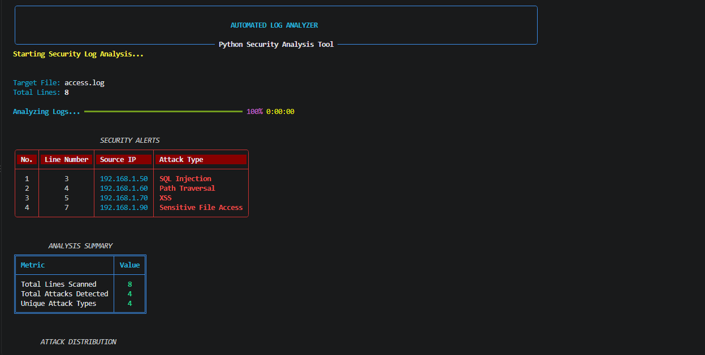
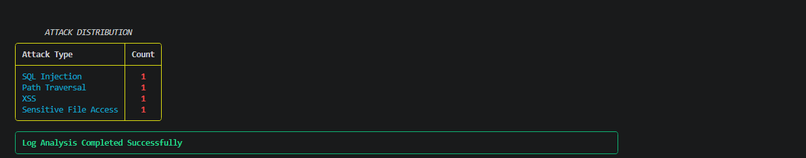

# 🔍 Automated Log Analyzer

A Python-based security tool designed for SOC Analysts to automatically analyze web server log files, detect suspicious activities, and generate security alerts using Regular Expressions (Regex).

The tool uses the **Rich** library to provide a professional and colorful terminal interface with progress indicators, security alert tables, and analysis reports.

## 🚀 Features

- **Automated Log Analysis:** Reads and analyzes web server log files.
- **Attack Detection:** Identifies suspicious patterns using Python Regular Expressions.
- **SQL Injection Detection:** Detects common SQL Injection patterns such as `UNION SELECT` and SQL conditions.
- **Path Traversal Detection:** Identifies directory traversal attempts and sensitive file access.
- **Command Injection Detection:** Detects suspicious command execution patterns.
- **XSS Detection:** Identifies potential Cross-Site Scripting payloads.
- **Sensitive File Access:** Detects attempts to access files such as `.env` and `wp-config.php`.
- **IP Address Extraction:** Extracts source IP addresses from log entries.
- **Security Alerts:** Displays attack type, source IP, and line number.
- **Attack Statistics:** Generates a summary of detected attacks.
- **Rich Terminal Interface:** Provides colorful tables, panels, and progress bars.

## 🛡️ Supported Attack Types

| Attack Type | Detection Examples |
|---|---|
| SQL Injection | `UNION SELECT`, `' OR 1=1` |
| Path Traversal | `../`, `/etc/passwd` |
| Command Injection | `; cat`, `| whoami` |
| Cross-Site Scripting (XSS) | `<script>`, `javascript:` |
| Sensitive File Access | `.env`, `wp-config.php` |

## 🛠️ Technologies Used

- Python 3
- Regular Expressions (`re`)
- Rich Library
- Collections (`Counter`)

## 📁 Project Structure

```text
Automated Log Analyzer/
│
├── log_analyzer.py
├── access.log
└── README.md
└── screenshots/
    ├── output.png
    ├── result_log.png
```

## ⚙️ Installation

### 1. Clone the Repository

```bash
git clone https://github.com/moathalhazi/Bootcamp/tree/main/Programming_Languages/Python_Assignments/Automated%20Log%20Analyzer
```

### 2. Navigate to the Project Directory

```bash
cd Automated Log Analyzer
```

### 3. Run the Tool


## 📋 Requirements

- Python 3.8 or later
- Rich library

Install Rich manually if needed:

```bash
pip install rich
```

```bash
python log_analyzer.py
```

## 📊 Sample Output

```text
╭────────────────────────────────────────────────────────────────────────────────────────────────╮
│                                        AUTOMATED LOG ANALYZER                                  │                       │                                                                                                │                        ╰──────────────────────────────────── Python Security Analysis Tool ─────────────────────────────╯
Starting Security Log Analysis...


Target File: access.log
Total Lines: 8

Analyzing Logs... ━━━━━━━━━━━━━━━━━━━━━━━━━━━━━━━━━━━━━━━━ 100% 0:00:00


                      SECURITY ALERTS                       
╭─────┬─────────────┬──────────────┬───────────────────────╮
│ No. │ Line Number │ Source IP    │ Attack Type           │
├─────┼─────────────┼──────────────┼───────────────────────┤
│  1  │      3      │ 192.168.1.50 │ SQL Injection         │
│  2  │      4      │ 192.168.1.60 │ Path Traversal        │
│  3  │      5      │ 192.168.1.70 │ XSS                   │
│  4  │      7      │ 192.168.1.90 │ Sensitive File Access │
╰─────┴─────────────┴──────────────┴───────────────────────╯


         ANALYSIS SUMMARY         
╔════════════════════════╤═══════╗
║ Metric                 │ Value ║
╟────────────────────────┼───────╢
║ Total Lines Scanned    │   8   ║
║ Total Attacks Detected │   4   ║
║ Unique Attack Types    │   4   ║
╚════════════════════════╧═══════╝


       ATTACK DISTRIBUTION       
╭───────────────────────┬───────╮
│ Attack Type           │ Count │
├───────────────────────┼───────┤
│ SQL Injection         │   1   │
│ Path Traversal        │   1   │
│ XSS                   │   1   │
│ Sensitive File Access │   1   │
╰───────────────────────┴───────╯
╭────────────────────────────────────────────────────────────────────────────────────────────────╮
│ Log Analysis Completed Successfully                                                            │
╰────────────────────────────────────────────────────────────────────────────────────────────────╯
```

*Output is an illustrative example based on sample log entries.*

## 🧠 Key Python Concepts

This project demonstrates practical usage of:

- `open()` and `with` for file handling.
- `enumerate()` for tracking line numbers.
- `re.compile()` for compiling detection patterns.
- `re.IGNORECASE` for case-insensitive matching.
- `re.search()` for pattern matching.
- `Counter()` for attack statistics.
- Functions and modular programming.
- Exception handling.
- Rich library for terminal visualization.

## 📸 Screenshots

### Analysis Summary




## ⚠️ Disclaimer

This tool is developed for educational purposes and cybersecurity training.

It identifies suspicious patterns in log files but does not confirm that an actual attack has occurred. Further investigation is required to validate security incidents.

## 👨‍💻 Author

**Moath Al-Hazi**