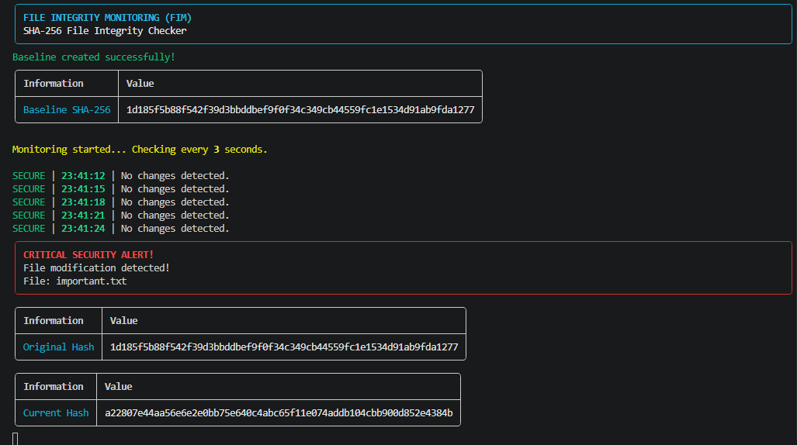

# 🛡️ File Integrity Monitoring (FIM)

A Python-based File Integrity Monitoring (FIM) tool designed to detect unauthorized modifications to sensitive files using SHA-256 cryptographic hashing.

The tool creates an initial hash baseline and continuously monitors the target file. Any change in the file's content triggers a **Critical Security Alert**.

## 🚀 Features

- **SHA-256 Hashing:** Calculates file fingerprints using Python's `hashlib`.
- **Baseline Creation:** Creates an initial reference hash.
- **Continuous Monitoring:** Checks file integrity every 3 seconds.
- **Change Detection:** Detects unauthorized file modifications.
- **Critical Alerts:** Displays security alerts when changes are detected.
- **File Deletion Detection:** Detects when the monitored file is deleted.
- **Memory Efficient:** Reads large files in binary chunks.
- **Rich Terminal Interface:** Provides professional terminal output using Rich.

## 🛠️ Technologies Used

| Technology | Purpose |
|---|---|
| Python 3 | Main programming language |
| hashlib | SHA-256 hash calculation |
| time | Monitoring intervals |
| pathlib | File path handling |
| Rich | Terminal formatting and alerts |

## 📂 Project Structure

```text
File-Integrity-Monitoring/
│
├── fim.py
├── important.txt
├── README.md
│
└── screenshots/
    └── outputs-summary.png
```

## ⚙️ Installation

**1. Clone the repository**

```bash
git clone 
```

**2. Navigate to the project directory**

```bash
cd File-Integrity-Monitoring
```

**3. Install dependencies**

```bash
pip install rich
```

## ▶️ Usage

Run the program:

```bash
python fim.py
```

Enter the file path you want to monitor:

```text
Enter file path to monitor: important.txt
```

The tool will automatically:

1. Calculate the initial SHA-256 hash.
2. Create the reference baseline.
3. Start monitoring the selected file.
4. Recalculate its hash every 3 seconds.
5. Compare the current hash with the original baseline.
6. Trigger a Critical Security Alert if a modification is detected.

## 📸 Screenshots

### 1. Outputs Summary




## 🧪 Testing

To test the tool:

1. Create a file named `important.txt`.
2. Add some text to the file.
3. Run the monitoring tool.
4. Modify the file while the tool is running.
5. Save the changes.
6. Observe the Critical Security Alert in the terminal.

## 🔐 Security Concepts

- File Integrity Monitoring (FIM).
- Cryptographic Hashing.
- SHA-256 Algorithm.
- Baseline Integrity Verification.
- Unauthorized Modification Detection.
- Security Monitoring and Incident Response.

## ⚠️ Limitations

- The baseline is stored in memory and is not persistent.
- Only one file is monitored at a time.
- The monitoring interval is fixed at 3 seconds.
- File permission and metadata changes are not monitored.
- This is an educational implementation, not a production-grade security solution.

## 🎯 Project Objective

The objective of this project is to understand how cryptographic hashing can be used to monitor file integrity, detect unauthorized modifications, and support security incident response operations.

---

**Developed as part of the Cybersecurity Bootcamp Assignments.**

**Author:** Eng. Moath Al-Hazi
