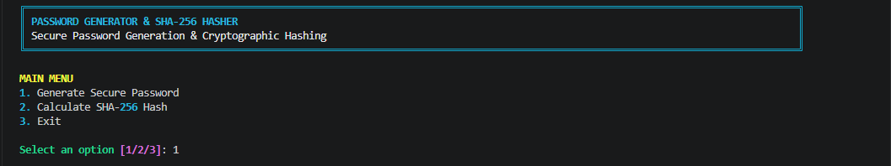
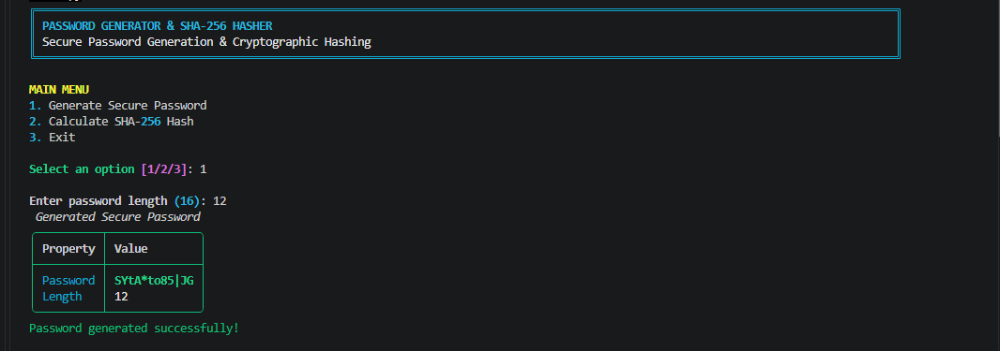
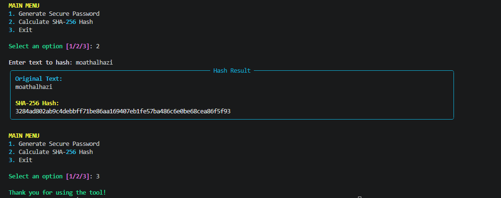

# 🔐 Password Generator & SHA-256 Hasher

A Python-based cybersecurity tool that provides two essential security functions: generating strong and cryptographically secure passwords, and calculating SHA-256 cryptographic hashes for text.

The tool features a professional command-line interface powered by the **Rich** library.

## 🚀 Features

### 🔑 Secure Password Generator
- Generates random passwords with customizable length.
- Includes uppercase letters (A-Z).
- Includes lowercase letters (a-z).
- Includes numbers (0-9).
- Includes special characters and symbols.
- Uses Python's `secrets` module for cryptographically secure randomness.
- Guarantees at least one character from each category.

### 🔏 SHA-256 Hasher
- Calculates SHA-256 cryptographic hashes.
- Converts input text into UTF-8 encoded bytes.
- Displays the resulting hash in hexadecimal format.
- Uses Python's built-in `hashlib` library.

### 🎨 User Interface
- Interactive command-line menu.
- Professional terminal output using Rich.
- Formatted tables and panels.
- Easy-to-use interface.

## 🛠️ Technologies & Libraries

| Technology | Purpose |
|---|---|
| Python 3 | Programming Language |
| secrets | Secure Random Generation |
| string | Character Sets |
| hashlib | SHA-256 Hashing |
| Rich | Terminal User Interface |

## 📂 Project Structure

```text
Password-Generator-SHA256/
│
├── password_generator_hasher.py
└── README.md
└── screenshots/
    ├── main_menu.png
    ├── password_generator.png
    └── sha256_hasher.png
```

## ⚙️ Installation

### 1. Clone the Repository

```bash
git clone 
```

### 2. Navigate to the Project Directory

```bash
cd Password-Generator-SHA256
```

```bash
pip install rich
```

### 3. Run the Application

```bash
python password_generator_hasher.py
```

## 💻 Usage

After running the script, the main menu will appear:

```text
1. Generate Secure Password
2. Calculate SHA-256 Hash
3. Exit
```

### Option 1: Generate Secure Password

Select option `1`, then enter your desired password length.

Example:

```text
╔═══════════════════════════════════════════════════════════════════════════════════════════════════════════════════════════════════╗
║ PASSWORD GENERATOR & SHA-256 HASHER                                                                                               ║
║ Secure Password Generation & Cryptographic Hashing                                                                                ║
╚═══════════════════════════════════════════════════════════════════════════════════════════════════════════════════════════════════╝

MAIN MENU
1. Generate Secure Password
2. Calculate SHA-256 Hash
3. Exit

Select an option [1/2/3]: 1

Enter password length (16): 12
 Generated Secure Password 
╭──────────┬──────────────╮
│ Property │ Value        │
├──────────┼──────────────┤
│ Password │ SYtA*to85|JG │
│ Length   │ 12           │
╰──────────┴──────────────╯
Password generated successfully!

```

### Option 2: Calculate SHA-256 Hash

Select option `2`, then enter the text you want to hash.

Example:

**Input:**
```text
╔═══════════════════════════════════════════════════════════════════════════════════════════════════════════════════════════════════╗
║ PASSWORD GENERATOR & SHA-256 HASHER                                                                                               ║
║ Secure Password Generation & Cryptographic Hashing                                                                                ║
╚═══════════════════════════════════════════════════════════════════════════════════════════════════════════════════════════════════╝

MAIN MENU
1. Generate Secure Password
2. Calculate SHA-256 Hash
3. Exit

Select an option [1/2/3]: 2

Enter text to hash: moathalhazi
╭─────────────────────────────────────────────────────────── Hash Result ───────────────────────────────────────────────────────────╮
│ Original Text:                                                                                                                    │
│ moathalhazi                                                                                                                       │
│                                                                                                                                   │
│ SHA-256 Hash:                                                                                                                     │
│ 3284ad802ab9c4debbff71be86aa169407eb1fe57ba486c6e0be68cea86f5f93                                                                  │
╰───────────────────────────────────────────────────────────────────────────────────────────────────────────────────────────────────╯
MAIN MENU
1. Generate Secure Password
2. Calculate SHA-256 Hash
3. Exit

Select an option [1/2/3]: 3

Thank you for using the tool!

```

## 📸 Screenshots

Add your project screenshots to a folder named `screenshots`.

Example:

### Main Menu


### Password Generator


### SHA-256 Hasher


## 🔐 Security Concepts


### 1. Cryptographically Secure Randomness

The project uses Python's `secrets` module instead of the standard `random` module.

The `secrets` module is designed for generating security-sensitive random values that are difficult to predict.

### 2. Cryptographic Hashing

SHA-256 is a member of the SHA-2 cryptographic hash family.

It produces a fixed-length digest of 256 bits (64 hexadecimal characters).

### 3. Encryption vs. Hashing

| Encryption | Hashing |
|---|---|
| Reversible with the correct key | Designed to be one-way |
| Uses encryption keys | Does not require a decryption key |
| Protects data confidentiality | Supports integrity verification |

> **Security Note:** SHA-256 alone is not recommended for password storage. Real-world applications should use password-hashing algorithms such as Argon2id, bcrypt, or scrypt with unique salts.

## 🧪 Testing

The application can be tested using the following scenarios:

- Generate passwords with different lengths.
- Verify that all character categories are included.
- Generate multiple passwords and compare their outputs.
- Calculate the SHA-256 hash of different text inputs.
- Verify the SHA-256 output against known test vectors.
- Test invalid password lengths.

## 🎯 Assignment Objectives

This project was developed as part of a cybersecurity programming assignment to demonstrate:

- Secure random password generation.
- Python cryptographic libraries.
- SHA-256 hashing implementation.
- Character encoding and hexadecimal representation.
- Basic command-line application development.

## 👨‍💻 Author

**Eng. Moath Al-Hazi**